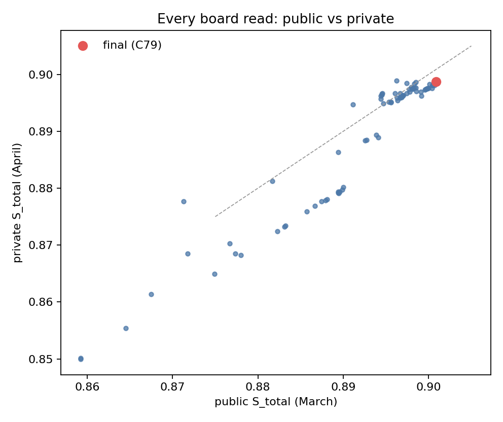
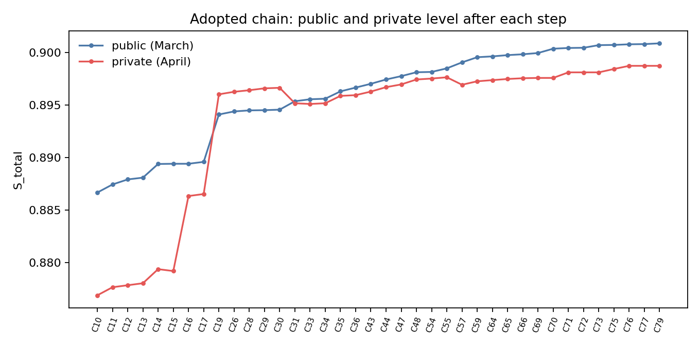

# 8th place: learn on the scored month, trust only what you can measure

Thanks to the organisers of the 2026 IEEE BigData Cup for a benchmark with four very different tasks in one score, and congratulations to the top teams.

- Private score .89874 (8th), public .90088. Scored file: C79.
- Code and weights: https://github.com/AminMohamed-3/trafficflowbench-2026
- Interactive write-up: https://aminmohamed-3.github.io/trafficflowbench-2026/
  - all 91 board reads with their April scores;
  - the 267-row idea registry;
  - a space-time map of where our state error lives.
- Author: Amin Mohamed.
- We stopped development on 21 October, 17 days before the close. Our last upload was on 20 October.

## TL;DR

1. **Each split is its own scenario.** A queue CNN beat persistence by +.115 on January and February, but only by +.015 on March. So we stopped trusting train-month validation and learned on the scored month wherever the rules allowed it.
2. **New label sources beat new inputs.** Released cells of the scored month, used as training labels for a per-month masked U-Net, gave the largest late gains on state.
3. **We forecast every upload before making it.** Each component had an offline instrument, and 90 of our 91 submissions had a forecast and a band written before the upload.
   - State and physics pieces landed in the band 31 times out of 32.
   - Pieces built on new label sources read above their forecast (3 of 6 in band), because no offline test could see their full value.
   - Queue forecasts got the sign right only 14 times out of 37, so we treated them as priors, not measurements.
4. **State pieces carried to April; late queue pieces did not.** After C47, state carried 1.04× from March to April and ongoing 0.03×.
5. **ODME:** we ship the organiser's own NNLS (λ = .05). Every move away from it lost.

## What carried from March to April

| | public (March) | private (April) |
|---|---|---|
| canonical baseline | .83664 | .81725 |
| C03, first adapted queue CNN | .88225 | .87242 |
| C47, base of the final chain | .89776 | .89697 |
| **final file (C79)** | **.90088** | **.89874** |

The final file is C79. The April rows of its last two pieces (W1.0 and S7c-INEL) were built later, as C80, and never uploaded. So the private score contains no piece added after C76.

- From the baseline to the final file, private rose +.08149 against +.06424 public.
- From C47 to the final file, private rose +.00177 against +.00312 public. The split by component is the result:

| after C47 | steps | Σ public | Σ private | carry |
|---|---|---|---|---|
| state (learned on the scored month) | 13 | +.00166 | +.00173 | 1.04× |
| ongoing (members trained on train months, adaptation) | 4 | +.00146 | +.00004 | 0.03× |

- Two early steps moved April far more than March. Each is about two April windows, so luck is possible.
  - Q0436 (onset switches) read 0 public and +.00714 private.
  - The selection-conditioned ongoing twin (C19) read +.00451 public and +.00949 private.
  - Without C19, the ongoing steps sum to about +.0036 public and −.0004 private.
- Late in the competition, the public board ranked our files poorly for April.
  - Over all 91 files, public and private agree (Spearman .95). Over the 37 files from 12 October on, Spearman is .56.
  - Our best April file (.89887) was a rejected ongoing-member change. It beat the final file by .00013, a small fraction of one window, so the gap is noise.
- The useful rule is the one in the table above: trust state pieces measured on the scored month, and treat late queue reads as noise unless they move several windows.

*Every read: public (March) vs private (April). The final file is marked.*

*The adopted chain from C03: public and private level after each step.*

## Data and metric in one paragraph

The data are ten synthetic freeway corridors at 5-minute resolution: speed, flow and occupancy per station, plus ramps, published fundamental-diagram parameters and a network file.

The score is S_total = .35 state + .15 onset + .15 ongoing + .15 physics + .20 ODME, where:
- **State** fills blanked cells. 20%, 30% or 50% are blanked per day.
- **Onset and ongoing** forecast which links queue at T+5 to T+30, scored by space-time IoU. They are online: only data at or before T. One window is worth .00375 S_total.
- **Physics** scores our own state rows: one third fundamental-diagram fit, two thirds LWR conservation.
- **ODME** estimates OD demand from link counts and a prior.

Our board-implied levels are:

| component | level | points lost |
|---|---|---|
| state | .947 | .019 |
| onset | .832 | .025 |
| ongoing | .883 | .018 |
| physics | .754 | .037 |
| ODME | .9933 | .001 |

## State (Task 1), 35% of the score

Each corridor and month is processed alone, from that month's released cells, the published constants and models fitted on train or on the same month.

1. **Base stack.** The pieces, with their public gains:
   - Two pooled LightGBM residual models using the month's own station levels (+.018).
   - A split-local LightGBM fitted on pseudo-targets from the month's released cells.
   - Physical stages (+.0044 together):
     - a corridor-wide common-mode speed shock;
     - a hedge on cells whose free or congested class is uncertain;
     - same-time kriging of log flow;
     - projection of congested cells toward the congested branch of the published FD.
   - Residual LightGBM stages, an occupancy model, a gap specialist for the 90-minute blackouts around Task 2 windows, and a speed clip.
2. **B6, a per-month masked U-Net.**
   - Trained only on the visible cells of the scored month, with random blanking.
   - Three seeds per corridor, blended per corridor with the stack.
   - Later extended with longer training (12k to 48k iterations) and ramp and occupancy channels.
3. **New labels in the official view.** These were the biggest late wins.
   - The U-Net was first trained on our own view, which hides cells to make labels. In the official view, 18.4% of released cells are visible that our own view had hidden.
   - **FV-FT.** We continued training every member for 6k iterations with those cells as labels: +.00041.
   - **FV-INEL.** About 7% of cells are released but never scored (their coverage is below the eligibility threshold). We call them INEL cells; none of them is a scored target in either month (0 of 981k in March, 0 of 949k in April).
     - Used as extra labels (never as inputs), they gave +.00025.
4. **Stage learner on the new labels (S7c-INEL).** 60 continued boosting trees on the stage-3 model, fitted on INEL cells.
   - The board read +.00007, but that is over the forecast level of its unread parent.
   - Held out, it is worth +.00002 (March) and +.000016 (April), and that is the value we believe.
   - It is in the March rows of the final file only.
5. **Gap rows.** The 128k cells inside the 90-minute blackouts get their own models: a ramp-conditioned gap U-Net member, refit weights, an edge taper and a rebuild over the final chain.

How good is it? We picked the March day with the most congested INEL cells (D12 I-405 S, 18 March).
- On that day, models that never saw half of the INEL cells predict those 934 cells with a speed RMSE of 2.0 km/h, against a released-speed SD of 18.9 km/h.
- INEL cells sit among released neighbours, so this is easier than the official 20% to 50% masks.

Where the rest of the error lives: 2.2% of cells, at queue fronts, hold 85% of the improvable March error (79% in April). No released input we tried predicted that front error across dates.

## Physics (Task 3)

Physics is scored on our own Task 1 rows, so every state piece is also a physics piece.
- LWR is 99% of our physics loss, and lone hidden cells carry most of it.
- We used physics through the forecast unit (below) and through flow-targeted stages.
- Direct corrections failed:
  - a temporal smoothing kernel lost .0056;
  - a cell transmission model reproduced interior speeds worse than linear interpolation.
- Our cells sit closer to the published FD than the observations do (FD loss .009 vs .015). Part of this is because predictions are smoother than observations, so it is a plausibility check, not a gain.

## Onset (Task 2)

An onset queue appears only at T+30, on a few cells at one bottleneck, so the task reduces to picking the site.
- A LightGBM classifier (Q03) on online precursors gives the site probabilities.
- The decoder picks the cell set with the highest expected IoU. It returns the top two sites when their probability ratio is at least .8.
- Two calibrated online switches and an agreement rule (Q0436) adjust the odds from the window's own history.

Results:
- Q03 gained +.0121 early.
- Q0436 changed three March windows and read exactly 0 public. We shipped it on pseudo-window evidence, and in April it read +.0071 (about two windows).
- About 55 later onset tests did not beat the chain.

## Ongoing (Task 2)

1. **Members.**
   - A 1-D CNN along the corridor, with five channels per link over 24 steps: speed over free speed, flow over capacity, occupancy, observed flag, queued flag.
   - Dropping time of day, position and the link prior removed most of the train-scenario overfit.
   - 5 seeds, 16 epochs, plus a selection-conditioned twin and a ConvNeXt-Tiny member (ImageNet weights) at weight .2.
2. **Per-date online adaptation.** This was the big one.
   - For each scored date, every member is fine-tuned on pseudo windows built from released cells of earlier dates of the same month and day type: 5 epochs, learning rate 6e-4.
   - Cold dates use a two-stage pool.
   - Each member's output is .75 adapted + .25 unadapted.
3. **Decode.** Expected-IoU top-k over the six horizons, a cap of .92 on the IoU with persistence, and a raise for a selection-flagged window type (type A).

The cap, the type-A raise and the twin's flags use how the organisers selected windows: a window is kept only if persistence IoU is at most .9.
- They are computed from data at or before T.
- 43 of 80 windows are type A, and the twin gave +.0045 public and +.0095 private.

## ODME (Task 4)

We minimise ||Af − c||² + .05 ||f − b||² with f ≥ 0, on each split's own counts and prior. This matches the organiser solver to 2.6e-11.
- The counts leave 595 to 4,950 free dimensions, and every alternative we tried lost on the board.
- An audit of stored reads suggests the hidden reference is the projection plus about 1.5% random per-path scatter.
- Our board-implied S_ODME is about .9933.

## How we validated

| instrument | what it does | record |
|---|---|---|
| I-S-OWN | hides 10% of observed cells plus 90-minute blocks in the scored month | with the other Task 1 instruments: 31 of 32 state and physics reads inside the written band |
| I-S-INEL | scores the full shipped chain at INEL cells hidden like targets | calibrated once, then predicted the next piece at 1.05× |
| INEL-FOLD | members trained on half of the INEL cells, scored on the other half | pre-registered gate passed in both months |
| gap bench | simulated blackouts with date folds | board = .308 × its state delta |
| pseudo windows (I-Q-SPLIT) | queue windows built from released cells | right sign for early adaptation, wrong for output corrections |

- For a state piece our forecast was .88 × (.35 ΔState + .45 ΔPhysics).
- The physics weight is about three times its nominal share. Our own view hides about 10% of cells, the official mask 20% to 50%, and LWR error grows with the hidden share.
- Board noise: a state piece shows its true effect within about .00001; a queue piece moves the board in steps of up to .00375 per window.
- Adopted reads of +.00002 to +.00003 are at the state noise level.

## What did not work

We kept a registry of 267 ideas. Each has a verdict and the smallest effect its test could have seen:
- 45 adopted;
- 108 refuted, meaning a powered test said no;
- 80 undetected, meaning the test could not see the expected effect;
- 16 had a broken instrument, 16 were reasoned out without a test, and 2 passed offline but were not shipped.

The most useful negatives:
- Bigger queue ensembles and longer pretraining on train months won offline and lost on the board.
- Output corrections fitted on pseudo windows read the wrong sign.
- New input channels for the U-Net (including INEL cells as inputs) did not pass their gates.
- More seeds, a wider net and test-time augmentation for the imputer all read below .0002, the smallest effect that test could see (fourth seed −.00002, six seeds +.00004). A later, finer instrument found the third seed worth about +.0001 in April but not in March, so small seed gains may exist.
- Every ODME alternative lost (regularisation, priors, path models).
- Small probability gains rarely flip a decoded queue cell. The median official window has no cell within .034 of the threshold.

## What we would do differently

- Spend the late weeks on physics, our weakest component, rather than on ongoing pieces that did not carry.
- Read queue pieces only as bundles that move several windows.
- Keep developing to the close: most teams above us submitted until 6 and 7 November.

## Rules and disclosures

- **Online rule.** Task 2 uses only data at or before T on the date, earlier dates of the same split, and train. Two read-only audits checked it, and replays with permuted rows and changed IDs left every queue output unchanged.
- **No identifiers as features.** No IDs, row order, window numbering or generator seeds.
- **Selection-implied inputs.** See the end of the Ongoing section.
- **Declared April methods.** Some April rows use a method chosen by a March board read, carried to April by a declared rule.
- **Open audit gaps.** The future-poison test was not run inside the final build. The "no April data in a March row" check holds by structure (one split per load), not by a mechanical test.
- **External weights.** One ConvNeXt-Tiny with ImageNet-1k weights. No external data.

## Reproducing

The repository rebuilds the scored file C79 (sha256 104c2c6f…) and C80 from the competition data and our weights, on CPU.
- **Hardware:** a 16-thread laptop with 15 GB RAM. Peak RAM is 7.5 GiB.
- **Runtime:**
  - the base runs in WSL2 in about 3.5 h with our fitted S08 files, or about 9 h with a full refit;
  - the 17 pieces run in Windows Git Bash in 12 to 13 h.
- **Weights:** 4.1 GB, downloaded from the GitHub release and checked by sha256.
- **Checks:** each step compares its output with our stored development file of that step. It passes if the sha256 is equal, or if queue and ODME rows are exact and state rows are within 1e-8.
- **Stored outputs.** Five steps use sha-pinned stored outputs instead of re-serving:
  - rows 21, 22, 23 and 26, because the originals ran on a GPU or another machine and floats differ in the last bits;
  - row 33, Q-ACCUM, whose per-date fits ran inside Kaggle kernels and have no weights.
- **Lost weights.** The base build's ConvNeXt member is also stored: its fine-tuned weights were lost. Row 21 replaces it with a retrain whose weights are saved.
- **Verification run:** [CHAIN RESULT]

## How it was built

One person set the goal, the budget, the rule interpretations and the final selection. AI coding agents did the engineering: Codex lanes coordinated by a Claude planner until 8 October, then Claude Code alone, running as a harness. The harness kept state in files (registry, ledger, calibration table) and launched helper agents for ideation, ranking, line work and critique.
- A hook blocked uploads without a manifest line and a written forecast.
- Our own mistakes:
  - wrong headroom estimates that sent two lanes to ODME;
  - a destroyed rented machine that took one member's weights with it.
- Each mistake became a rule: save weights and a recipe at adoption.

Questions welcome in the comments.
