# Learn on the scored month, trust only what you can measure

Amin Mohamed

2026 IEEE BigData Cup: TrafficFlowBench. Method report for the final package (code and report due 2026-11-10).

**How to read the sources.** Every number carries a source in square brackets. T1 to T5 and F1 to F14 are the tables and
figures of this report (Appendix F lists their data files). Other keys: "ADOPTED n" = row n of docs/report/ADOPTED.md;
"Rnnn" = row of the idea registry docs/research/registry/REGISTRY.tsv; "Lnnnn" = row of LEDGER.md; "calib" =
docs/report/board_calibration.csv; "DIGEST" = DECISIONS_DIGEST.md. Public = March 2031 (validation split), private = April
2031. All scores are S_total unless marked otherwise.

---

## 1. Summary

**Result.** Our scored file C79 scores .89874 on the private board (April), 8th place, and .90088 on the public board
(March) [P4; calib]. The winning private score was .92823. C80 adds the April rows of ADOPTED 34 and 35 and was never
uploaded.

**Expected private.** Our records hold no forecast of the absolute private score. They hold a private forecast per adopted
piece. For the pieces added after C47 that state a point value (ADOPTED 21 to 23 and 29 to 35), these sum to about
+.0011 over C47's private level (rows 21 to 23: +.0003; rows 29 to 35: +.00084), against +.00191 public on the same rows
[T2, column "private fc"]. Row 20 states only a range (+.00002 to +.00008); rows 19 and 24 to 28 state none. The per-piece ranges in T2 are not independent intervals, so we do not
combine them into one interval. April evidence for the largest April piece is positive: the INEL-FOLD instrument reads the
April FV-INEL class at +.00018 [+.00006, +.00032] in board units, held out [F10; F11;
artifacts/claude_ref/l_inelfold/GATE.json].

**Three ideas mattered.**
1. *Learn on the target month, and trust only what it can measure.* Each split is its own scenario (section 2). Task 1
   state and physics pieces, learned and measured on the scored month, read on the board at a median 1.00x their forecast
   (18 reads), and 31 of 32 such reads fell inside the band written before the upload [F3; F4]. Ongoing members trained on
   train months read at .2x or below zero (two reads near .2x, three negative) [F4]. For queue adaptation the rule did not
   hold: after the 2026-10-11 review, adaptation reads came in at a median -4.2x their forecast [F4]. This record is why
   line effort moved to state pieces [DIGEST, 2026-10-17].
2. *New label sources beat new inputs.* Released cells of the scored month used as training labels gave the largest late
   gains: FV-FT +.00041, FV-INEL +.00025, S7c-INEL +.00007 (held out +.00002, section 8); together the label steps gave +.00077,
   a quarter of the +.00312 gained after C47 [T2 rows 28 to 35; F10]. INEL cells used as five new input channels did not
   pass their gate (interval not above 0 in one month, with a leak flag; the mechanism was not cleanly tested) [R228,
   UNDETECTED], and no released input, local or long-range, predicted the remaining
   front error across dates [docs/research/ideas_R6/R6A.md section 2].
3. *Powered instruments and a registry.* Our registry holds 267 ideas, each with a verdict class and, where tested, the
   smallest effect its test could see [F5; REGISTRY.tsv]. 90 of our 91 submissions carry a forecast written before the
   upload [F3; T4]. New instruments had to pass a
   pre-registered gate before use [F11].

## 2. Task, metric and data

**Data.** A synthetic freeway benchmark: ten directional corridors (five families, two directions each) at 5-minute
resolution, with station speed, flow and occupancy, ramps, published fundamental-diagram (FD) parameters and a network file
[data/raw/kaggle_public/README.md]. Train covers June 2030 to February 2031. March and April 2031 are scored. The organisers
state that the two scored months were generated independently "with different incidents"
[docs/report/SOURCE_EVALUATION_2026-10-13.md].

**Four tasks, five scored components** [PLAN.md section 2; ref/trafficflowbench-public/src]:
- Task 1, state reconstruction: fill blanked speed and flow cells. One of three mask regimes per day hides 20%, 30% or 50%
  of eligible cells (R1, R2, R3). Score: .54 max(0, 1 - RMSE_v/25) + .46 max(0, 1 - RMSE_q_lane/600).
- Task 2, queue forecasting, onset and ongoing: for a window with origin T, predict the queued links at T+5 to T+30. Score:
  space-time IoU. Each split has 40 onset and 40 ongoing windows on eight corridors (D12_I405 N and S are excluded). One
  window is worth .00375 S_total [docs/research/ideas_R3/R3.md header].
- Task 3, physics: S_phys = S_FD/3 + 2 S_LWR/3, computed on our Task 1 rows. There is no separate physics submission.
- Task 4, origin-destination matrix estimation (ODME) from released link counts and a prior.

S_total = .35 state + .15 onset + .15 ongoing + .15 physics + .20 ODME, averaged over corridors in a family and then over
families. The host baseline scores .55343 on the public split [L0011].

**The online rule.** Task 2 is online. A forecast with origin T may use data stamped at or before T on that date, earlier
dates of the same split, and train. The organiser confirmed on 2026-10-15 that this also binds model fitting and model or
threshold selection, and that April windows may use released March data [DIGEST, 2026-10-15; forum thread 748789]. Tasks 1,
3 and 4 are offline: any released observation of the split may be used [RULES.md section 2].

**March and April are different scenarios.** Per-link hourly queue profiles correlate .98 to .999 between train months but
only .63 to .98 across splits. A corridor CNN beat persistence by +.115 on January and February, but by +.015 on March and
+.006 on April [docs/reference_code/qcnn_shift.py; docs/report/REPORT_DRAFT.md section 2a]. A simulator fitted to train
months could not be told apart from a held-out train month (AUC .46 to .49), while March and April fell outside it on 8 of 9
label-free statistics [exp/G_gen/GATE1.md].

## 3. Validation design

We never trusted one number. Each component had its own instrument, each instrument a record against the board (table
below), and 90 of the 91 board reads in our calibration table had a forecast written first [T5; DIGEST "Uploads and board"].

| instrument | population and labels | used for | record against the board |
|---|---|---|---|
| I-S-OWN | 10% of observed cells plus 90-minute blocks hidden in the scored month [L0184] | Task 1 pieces | with the other Task 1 instruments: 31 of 32 state and physics reads in band, median miss .00004 [F3; T4] |
| I-S-INEL | the full shipped state chain scored at released-but-ineligible (INEL) cells, hidden like targets [exp/L_isinel/INSTRUMENT.md] | stage refits that use new labels | gate PASS, k_fc 1.815, board/forecast 1.05 on the check piece [F11] |
| INEL-FOLD | members trained on one random half of INEL cells, served on the other half [exp/L_inelfold/LINE.md] | an honest chain of the shipped class | gate PASS both months [F11] |
| gap bench | simulated selector-like 90-minute blackouts, date folds, April reads counted [exp/L_gap/README.md] | gap rows | board = .308 x dState [exp/L_gap/score.py] |
| I-Q-SPLIT, TM-R | pseudo ongoing windows built from released cells of the scored month; TM-R matched to the official population, 2773 windows [exp/G_inst/INSTRUMENT.md section 7] | per-date adaptation screening | right sign for the early adaptation recipes (C03, C35), wrong for output corrections; later adaptation reads came in at a median -4.2x their forecast [F4] |
| OFF250 | 250 selector-replica windows in January and February, official input form [exp/G_inst/INSTRUMENT.md section 4] | veto for decoders, blends, stackers | 5 of 7 control reads agree in sign; blind to adaptation [same file] |
| BOARD | public score of a method file | final verdict on a method | 5 uploads per day; one window = .00375 |

**The forecast unit.** For state pieces the forecast is .88 x (.35 dState + .45 dPhys). The physics weight is three times
its nominal share because our own view hides about 10% of cells while the official mask hides 20% to 50%, and LWR error
grows with the hidden share: 1.97x (R1), 2.89x (R2) and 4.60x (R3) the own-view error on 43 held train dates
[exp/F4_3/RESULT.md].

**I-S-INEL.** About 7% of all cells are released but never scored, because their interval coverage is below the eligibility
threshold. Their labels have the same quality as eligible cells (speed residual rmse 4.09 vs 4.00 km/h) and they are spread
evenly over the day [docs/research/ADVICE_C73.md K1]. The metric scores only eligible targets, and no INEL cell is a target
in either month (intersection 0 of 981,093 March and 0 of 948,791 April INEL cells, against 3,451,376 and 3,284,419 scored target
cells; recomputed from the cache by make_figures.py) [T5;
artifacts/claude_ref/l_fvinel/inel_count_validation.json, inel_count_private.json]. Hiding them like targets gives a test
set in the official geometry. The instrument passed a pre-registered calibration gate: the scale factor k_fc = 1.815 was
fitted on one piece (FV) and predicted a second (FV2) at board/forecast 1.05 [F11; artifacts/claude_ref/l_isinel/GATE.json].
Intervals are joint date bootstraps with 500 draws.

**INEL-FOLD.** Once INEL cells were used as labels, I-S-INEL became blind to the shipped chain (in sample). We split INEL cells
into two halves per station-day, trained 30 members per half and month, and served each half from the members that never
saw it. Pre-registered gate: March fc > 0 with interval above 0 and 1.81 x fc inside [.00008, .0008]; April point > 0.
Result: March fc +.000249 [+.000107, +.000387], April +.000099 [+.000032, +.000177]: PASS. In board units (x 1.81) the
class is worth +.00045 [+.00019, +.00070] in March and +.00018 [+.00006, +.00032] in April; the March board read of
FV-INEL (+.00025 on C72, +.00027 on C71) lies inside the March interval [F10; F11;
artifacts/claude_ref/l_inelfold/GATE.json].

**Calibration record.** Of our 91 submissions, 90 carry a written forecast. The 32 Task 1 state and physics reads fell inside the written band 31
times, agreed in sign 30 times and missed by a median of .00004; the median ratio of board to forecast was 1.0. The 6
reads of target-month label pieces agreed in sign 5 times but fell in band only 3 times: they read above their forecast
(median 2.2x), because no offline test could see their full value [F4]. The 37 queue reads (onset and ongoing) agreed in
sign only 14 times and fell in band 19 times; the median miss was .0006 [F3; T4; calib]. Over all 90 reads, 72% fell in
band [T4]. We therefore treated state forecasts as
measurements and queue forecasts as priors. After the calibration review the user moved line effort to state pieces
[DIGEST, 2026-10-17].

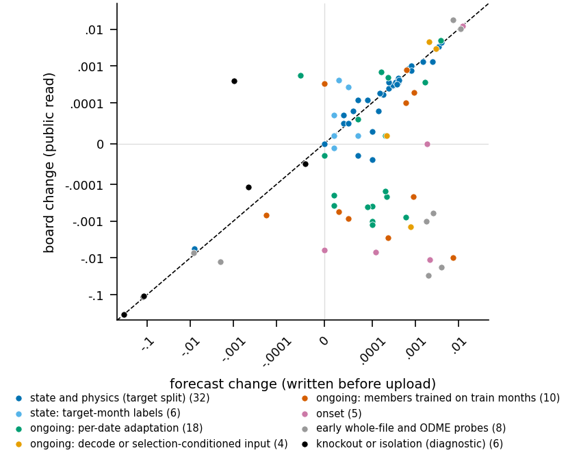

*F3. Forecasts written before each upload predict the board for Task 1 state pieces (31 of 32 in band, median miss .00004) but not for queue pieces (sign right in 14 of 37).*

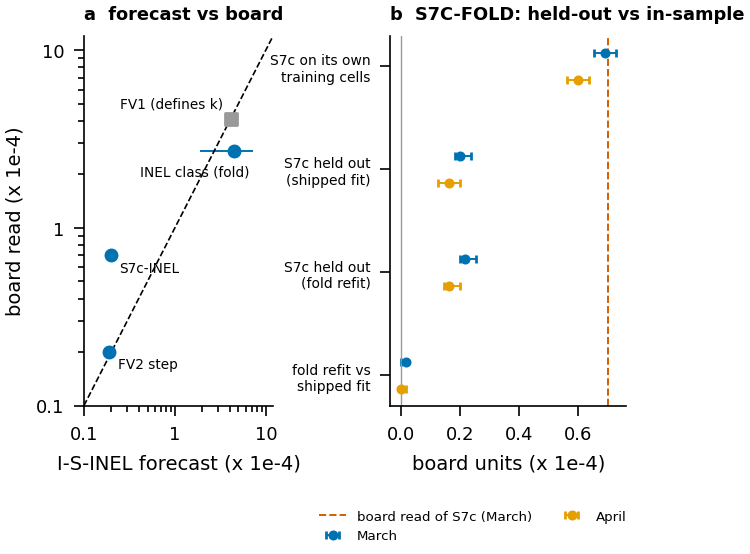

*F11. I-S-INEL, calibrated once on FV-FT, forecast the next step at board/forecast 1.05; the S7c read (+.00007) exceeds its held-out value (+.00002) and matches its in-sample value (+.000069).*

## 4. Method per component

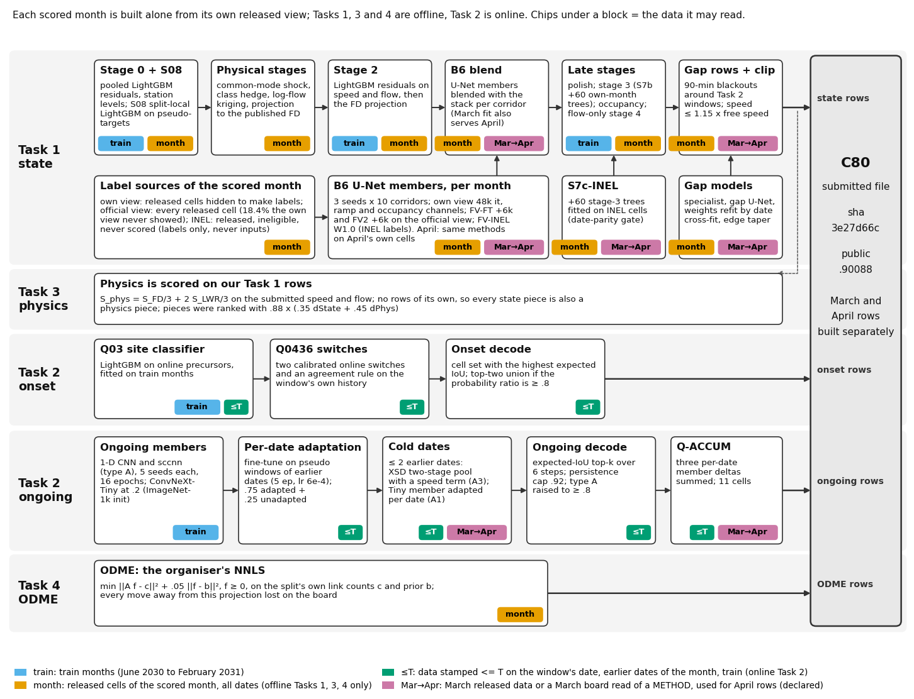

*F1. C80 is built per scored month from 20 blocks; the 11 that read the month's released cells are all in the offline Tasks 1, 3 and 4, the 8 Task 2 blocks read only train months and data stamped at or before T, and 7 blocks carry a March choice into April by a declared rule. Access tags are a declaration from the design documents; the audits are in T5.*

### 4.1 State (Task 1)

Each corridor and month is processed alone. Inputs are that month's released cells, the published constants, and models
fitted on train or on the same month.

**The base chain to C47** [Appendix A; docs/report/REPORT_DRAFT.md section 3]. Stage 0 is two pooled LightGBM residual models
with the month's own station levels (+.01807 on the board) [R001]. S08 adds a split-local LightGBM fitted on pseudo-targets
from the month's released cells [R002]. Physical stages follow: a corridor-wide common-mode speed shock, a class hedge on
cells whose free or congested state is uncertain, same-time kriging of log flow, and a projection of congested cells toward
the congested branch of the published FD (together +.00443) [Appendix A]. Then residual LightGBM stages (stage 2 to stage
4), an occupancy model, a gap specialist for the 90-minute blackouts around Task 2 windows, and a speed clip.

**B6, the per-month masked imputer.** A convolutional U-Net is trained only on the visible cells of the scored month, with
random blanking, three seeds per corridor, and blended per corridor with the stack [R007]. It was extended in steps: longer
training (12k, 24k, 48k iterations), and ramp and occupancy channels (S2) [T2 rows 24, 26; Appendix A].

**New labels in the official view (FV-FT, FV2, FV-INEL, W1.0).** The B6 members were trained on our own view, which hides
cells to create labels. In the official view 18.4% of released cells are visible that our own view had hidden, and the
members had never fitted them [exp/L_fvft/LINE.md]. FV-FT continues training of all 30 members per month for 6000
iterations on the official view, with these cells as labels (+.00041) [T2 row 28]. FV2 adds 6000 more iterations (+.00002)
[row 30]. FV-INEL adds the INEL cells as labels with weight .3 (+.00025) [row 31]; W1.0 raises that weight to 1.0 (+.00002)
[row 34]. INEL cells are never inputs, only labels.

**Stage learners on the new labels (S7c-INEL).** 60 continued boosting trees on the shipped stage-3 model, fitted on INEL
cells of the honest FV2 chain and cross-fitted by date parity for the gate. I-S-INEL: March fc +.000011 [+.000009,
+.000013], April +.000008; board read +.00007 [T2 row 35; R265].

**Gap rows.** 128,465 gap rows (the 90-minute blackouts) get their own models: the gap specialist, a ramp-conditioned gap
U-Net member [row 19], gap-stage weights refit on March with date cross-fit [row 25], more iterations and a rebuilt blend
[row 27], an edge taper [row 29], and a rebuild over the current FV chain [row 32] [ADOPTED 19 to 32].

**What the output looks like.** On D12_I405_S, 2031-03-18 (the March day with the most released congested INEL cells,
chosen by that rule), the INEL-FOLD chain (C77 class, no S7c) predicts 934 held-out INEL cells with a speed RMSE of
2.0 km/h, against a released-speed SD of 18.9 km/h at the same cells [F6].

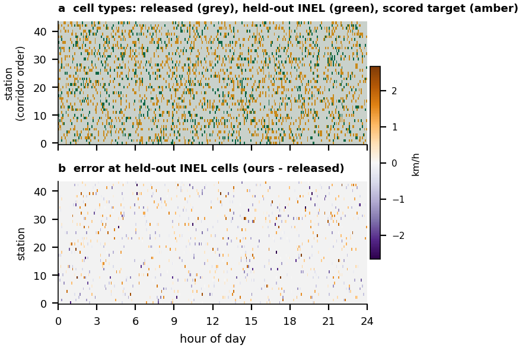

*F6. On held-out INEL cells of D12_I405_S on 2031-03-18 the chain has a speed RMSE of 2.0 km/h (1.4 km/h at congested cells) against an SD of 18.9 km/h. Released speed values are not drawn.*

### 4.2 Physics (Task 3)

Physics is scored on our Task 1 rows, so every state piece is also a physics piece. LWR is 99% of our submission-side
physics loss, and lone hidden cells carry about 88% of it in our own view (.0627 of .0716, March) [F8; docs/research/ideas_R5/R5.md 1b]. Physics measures the
L1 error of density times link length; state measures speed and flow RMSE with no length term [R5.md 1a]. We used the
physics term through the forecast unit (section 3) and through flow-targeted stages (kriging, joint projection, flow-only
stage 4) [Appendix A]. Direct physics corrections failed: a temporal smoothing kernel lost .00556 on the board [R052]; a
cell transmission model reproduced interior speeds worse than linear interpolation (RMSE 51 to 55 vs 27 to 28 km/h) [R051].

### 4.3 Onset (Task 2)

An onset queue appears only at T+30, on a few cells at one bottleneck [RULES.md section 2, organiser regularity]. The task
reduces to choosing the site. A LightGBM classifier (Q03) gives site probabilities from online precursors and is fitted on
train; the decoder picks the cell set with the highest expected IoU and returns the union of the top two sites when their
probability ratio is at least .8 [L0121]. Two calibrated online switches and an agreement rule (Q0436) adjust the odds from
the window's own history [L0408, L0414, L0436]. Q03 gave +.01211 [Appendix A]. Q0436 changed three public windows and read
exactly 0 [calib c16]; it ships on pseudo-window evidence for April. About 55 onset tests ran before 2026-10-11 and none
beat the chain [REVIEW section 4]; a clean-room model built without access to our onset code agreed with it on 35 of 40
official April windows [docs/report/REPORT_DRAFT.md section 5.1].

### 4.4 Ongoing (Task 2)

**Members.** A 1-D convolutional network along the corridor, with five channels per link (speed over free speed, flow over
capacity, occupancy, observed flag, queued flag) over 24 steps. Time of day, position and the link prior are dropped, which
removed most of the train-scenario overfit [docs/reference_code/qcnn_train.py; R098]. A selection-conditioned twin (sccnn)
serves type A windows (section 8, U1). Each kind has 5 seeds trained for 16 epochs on train months. A ConvNeXt-Tiny with
ImageNet-1k weights is blended at weight .2 [ADOPTED 4, 6, 9, 10, 21].

**Per-date adaptation.** For each scored date every member is fine-tuned on pseudo windows from released cells of earlier
dates of the same month and day type (5 epochs, learning rate 6e-4). On cold dates (two earlier days or fewer) a two-stage
pool (XSD) is used, which since C57 includes a speed term (A3). The ConvNeXt member is adapted per date as well (A1). Each
member's output is .75 adapted plus .25 unadapted [ADOPTED 7, 12, 13, 22, 23].

**Decode.** Expected-IoU top-k over the six horizon steps, a cap on the mask's IoU with persistence at .92, and a raise to
at least .8 on type A windows [L0469]. Q-ACCUM sums three small per-date member deltas and changes 11 cells [ADOPTED 33].

### 4.5 ODME (Task 4)

The organiser's NNLS: minimise ||Af - c||^2 + .05 ||f - b||^2 with f >= 0, on each split's own counts and prior. Parity
with the organiser solver: maximum path-flow difference 2.59e-11 [L0105]. The counts cannot pin the OD matrix (595 to 4950
free dimensions [L0107]), and every move away from the plain projection lost on the board [T3; R157 to R159]. A later audit
of six stored ODME reads found the hidden reference equal to the projection plus about 1.5% random per-path scatter, which
no construction can recover [R217]. Board-implied S_ODME is about .9933 [T1].

## 5. Where the score came from

F2 is the waterfall from C03 (.88225, the first file with the adapted ongoing CNN) to C80: 40 adopted steps (two change
April rows only), each with the forecast band written before its read. The three steps before C03 (Q03 onset, the tree
model for ongoing, the F4 state base) are in Appendix A [F2].

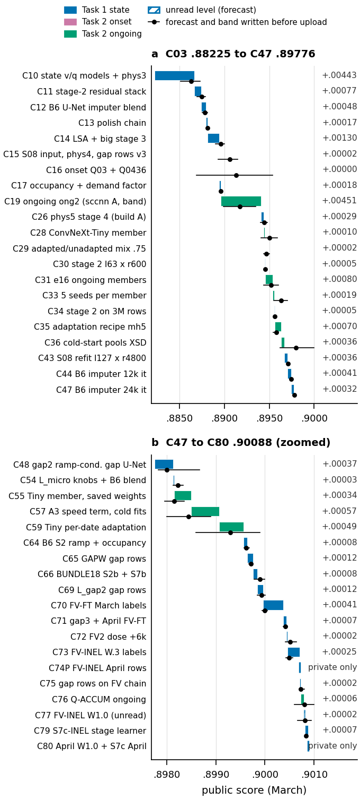

*F2. From C03 to C80 the public score rose +.01863 in 40 adopted steps (state +.01049, ongoing +.00814, onset 0); dots and bars are the forecast and band written before each upload.* T2 lists
the 17 pieces added after C47 and groups the earlier ones (full list in Appendix A).

**T2. Adopted pieces: board read vs forecast, and private forecast.** Board deltas are against the parent named in ADOPTED;
the forecast is the band centre written before the read [calib]. "n/s" = no private value stated in ADOPTED.

| row | piece | task | offline evidence (95% interval where given) | board delta | forecast | private fc (range) |
|---|---|---|---|---|---|---|
| pre-C03 | Q03 onset; tree model for ongoing; F4 state base | all | Appendix A | +.01211; +.01050; +.01807 | +.0127; +.0112; +.0076 | n/s |
| C03 to C47 | 13 state pieces (stack, imputer, S08 refit) | state | I-S-OWN, OPT [Appendix A] | +.00883 in sum | Appendix A | n/s |
| C03 to C47 | adapted CNN and 7 ongoing pieces | ongoing | I-Q-SPLIT, I-Q-RAW [Appendix A] | +.01161 in sum | Appendix A | n/s |
| 19 | gap2 U-Net member in gap rows | state | gap view, date folds: March +.00116 [+.00029, +.00201] | +.00037 | +.00024 | n/s |
| 20 | late-stage knob pair, B6 blend | state | I-S-OWN fc March +.000099, April +.000078 | +.00003 | +.00010 | +.00002 to +.00008 |
| 21 | ConvNeXt-Tiny retrained with saved weights | ongoing | parity with the old member | +.00034 | 0 | 0 (-.0003 to +.0003) |
| 22 | A3: speed term in cold-date fits | ongoing | TM-R March -.0038, April -.0033 IoU (intervals cross 0; opposite sign to the read) | +.00057 | -.00005 | +.0001 (-.0006 to +.0008) |
| 23 | A1: per-date adaptation of the Tiny member | ongoing | parity, future-poison pass | +.00049 | +.00023 | +.0002 (-.0003 to +.0007) |
| 24 | B6 S2: ramp and occupancy channels | state | I-S-OWN March +.000306 [+.000171, +.000452], April +.000231 | +.00008 | +.00006 | n/s |
| 25 | gap weights refit | state | gap bench March +.000131 [+.000033, +.000226], April +.000247 | +.00012 | +.00007 | n/s |
| 26 | bundle: B6 48k, gap rows, stage-3 continuation | state | March +.000138, April +.000120 | +.00008 | +.00014 | n/s |
| 27 | gap members +4k, blend rebuild | state | gap bench March +.000075, +.000213 | +.00012 | +.00009 | n/s |
| 28 | FV-FT March | state | none possible (cells seen) | +.00041 | +.00003 | in row 29 |
| 29 | gap edge taper + FV-FT April | state | gap bench March +.000244, April +.000101 | +.00007 | +.00004 | +.00047 |
| 30 | FV2 (+6k on the official view) | state | board only | +.00002 | +.00007 | +.00002 |
| 31 | FV-INEL (INEL labels, w .3) | state | board only (in sample at INEL) | +.00025 | +.00003 | +.00025 (-.00005 to +.0004) |
| 32 | gap rows over the FV chain | state | board only | +.00002 | +.00002 | +.00002 |
| 33 | Q-ACCUM | ongoing | board only | +.00006 | +.00007 | +.00004 (-.0004 to +.0004) |
| 34 | FV-INEL W1.0 | state | board only | +.00002 | +.00002 | +.00002 (-.00005 to +.0001) |
| 35 | S7c-INEL | state | I-S-INEL March +.000011 [+.000009, +.000013], April +.000008 | +.00007 | +.00002 | +.000015 |

Sources: rows 19 to 35 from ADOPTED 19 to 35 and calib; group rows from Appendix A. Intervals: date bootstrap; draws as
reported by each instrument (500 for I-S-INEL and the gap bench).

**Attribution by task** [T2; Appendix A]. From the canonical baseline (.83664) to C80 (.90088) the public score rose by
.06424. State and physics pieces gave .02856, ongoing pieces .02357, onset .01211, ODME 0 after the canonical baseline. From
C47 to C80 (+.00312), state pieces gave .00166 and ongoing pieces .00146 [T2 rows 19 to 35]. From C03, where F2 starts, to C80 (+.01863), state pieces gave .01049 and ongoing pieces .00814; onset read 0 [F2]. The
target-month label steps (rows 28, 30, 31, 34, 35) gave +.00077, a quarter of the gain after C47 [F10].

**What the waterfall does not prove.** Several ongoing reads are within window noise of zero, and one (row 21, +.00034) is a
new draw of an existing member that we attribute mostly to March luck; its private forecast is 0 [ADOPTED 21]. Three
ongoing pieces (rows 22, 23, 33) were adopted by a declared rule: the March read chose the method and the method was applied
to April rows [DIGEST, ruling 2026-10-15 (a)]. Their April value rests on that rule, not on an April measurement.

**Intervals.** The offline intervals of the last state pieces (joint date bootstrap, 500 draws) are in T2 and drawn in
F10 to F12. F14 draws the full date-bootstrap distributions.

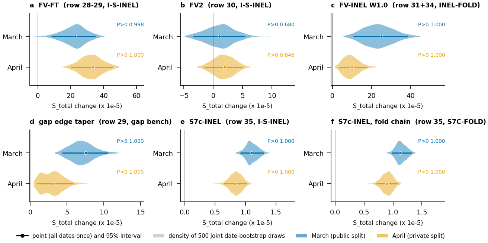

*F14. The last state pieces are above zero at 95% in 10 of 12 piece-months; only FV2 straddles zero (P>0 .68 March, .85 April); S7c-INEL is small but sure (March +.000011 [+.000009, +.000013]). Forecast units; board = 1.81 x forecast on I-S-INEL.*

## 6. Analysis

### 6.1 Where the remaining state error lives

We scored the shipped FV2 chain at INEL cells and split the error that lies above a measured noise floor [F9;
docs/research/ideas_R6/R6A.md section 1]:
- Queue fronts (a released cell within 2 steps or 2 stations lies on the other side of the congestion threshold) are 2.2%
  (March) and 2.4% (April) of cells but hold 85% and 79% of the improvable error.
- Four corridors (D12_I5_S, D12_I405_S, D12_I405_N, D7_I210_W) hold 71% and 69%. Hours 15 to 19 hold 70% and 63%.
- Cells with a speed error above 15 km/h are .031% of cells and carry 19% and 17% of the linear state loss. The chain gives
  a middle speed there while the truth is either a short dip or free flow.

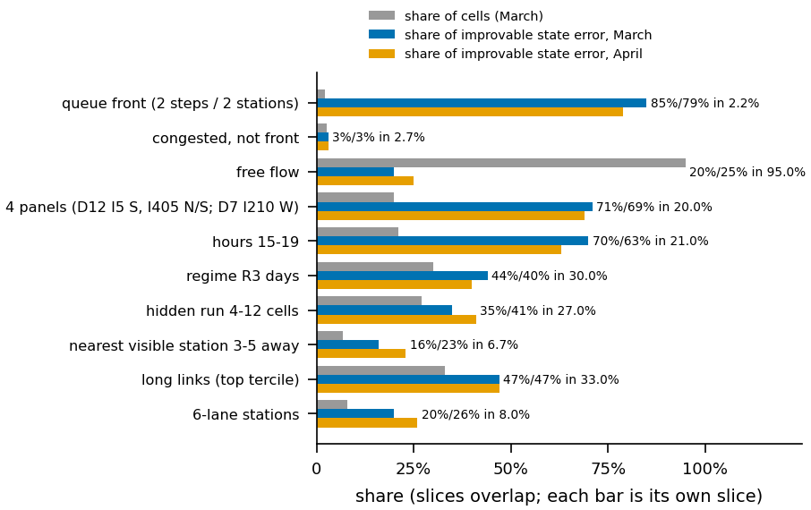

*F9. Queue-front cells are 2.2% (March) and 2.4% (April) of cells but hold 85% and 79% of the improvable state error.*

Can any released input see this error across dates? We fitted a date-cross-fitted LightGBM on the residual with five
feature families: local neighbours, INEL values, month climatology, ramp flows, and context beyond the U-Net's receptive
field. The gain at fronts was at most 0 in both months and the non-front gain at most +.00001 dState [R6A.md section 2].
What did move the front error was new labels from the same days: 76% to 84% of the S2b to FV2 label gain fell on fronts
[R6A.md section 1]. *Hypothesis:* the remaining information is day-specific and can only be learned inside the day. A direct
test of that (per-day test-time fine-tuning, DAY-TTT) overfit the visible cells and lost held-out accuracy (member error
+7.8% [+5.6%, +10.6%]) [R263], so the hypothesis is not confirmed.

### 6.2 Physics

Board-implied physics is about .754, the lowest component; the iid-noise floor is about .771, so about .017 physics
(.0026 S_total) is reachable in principle [T1; R5.md 1b]. Long links (top length tercile) hold 70% of the physics
sensitivity but 34% of the state sensitivity. A uniform 10% error cut would draw 65% of its forecast value from physics,
while our adopted pieces drew only about 14% from it [R5.md 1c]. Our state gains cut speed and flow errors in ways that left
density error mostly alone. F7 checks plausibility: at 968,856 held-out INEL cells of March our predictions
sit on the published FD at least as closely as the released observations (FD loss .010, .009 and .009 on R1, R2 and R3
days, against .015 for the observations); *hypothesis:* part of this is because predictions are smoother than
observations [F7]. F8 shows where mass balance breaks: at lone hidden cells and on long links [F8]. A physics idea that targeted this directly (length-weighted labels) was
tested late and was not detected on the board: one read at -.00001 against a noise of about .00001 [R264].

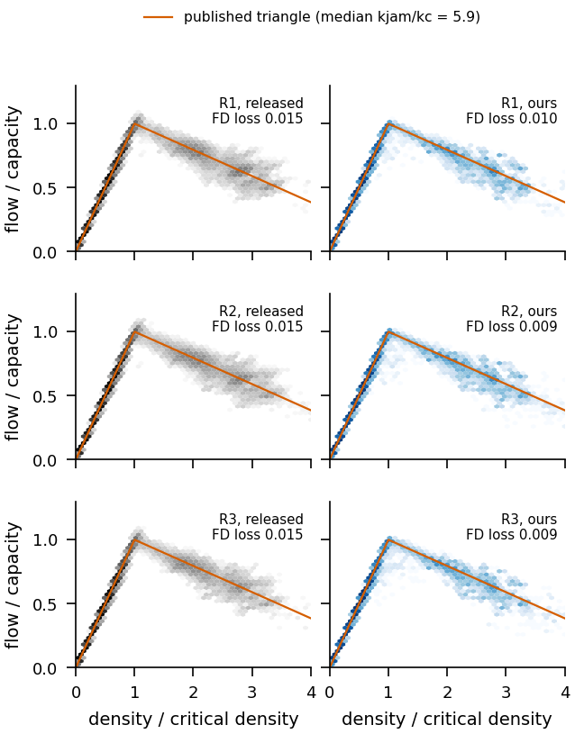

*F7. At 968,856 held-out INEL cells of March our predictions sit on the published fundamental diagram at least as closely as the observations (FD loss .009 to .010 against .015).*

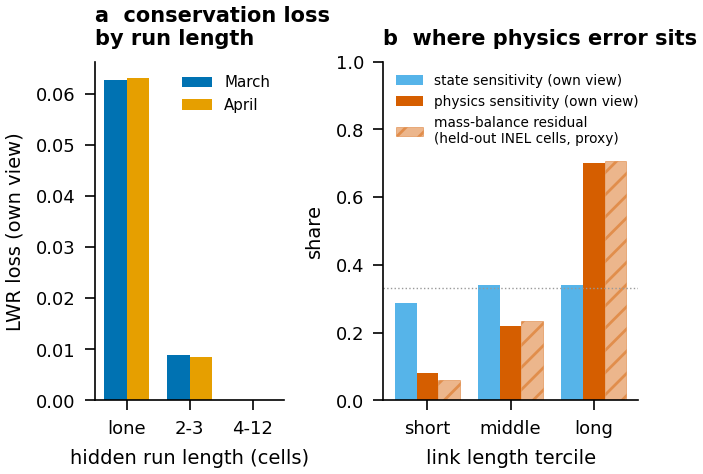

*F8. Lone hidden cells carry 88% of the LWR conservation loss, and the long-link tercile holds 70% of the physics sensitivity but 34% of the state sensitivity.*

### 6.3 Transfer from March to April

The transfer rule (section 1, idea 1) is a summary of reads, not a law [F4; REVIEW section 2]. *Hypothesis* [REVIEW section
2]: a bigger or longer-trained member fits the train scenario's queue dynamics better, and that extra fit is partly overfit to
the wrong scenario, while adaptation and split-local state models learn the new scenario directly. We add three April
observations. First, at member level the FV gain was 1.2x its March size in April and FV2 .85x [ADVICE_C73 K2]. Second, the
I-S-INEL calibration gave an April/March ratio of 1.49 for the FV step [artifacts/claude_ref/l_isinel/GATE.json,
ratio_fc_apr_over_mar_fv]. Third, the two-to-three seed step of B6, measured on I-S-INEL with leave-one-seed-out
arms, is worth +.000093 [+.000066, +.000119] board units in April but only +.000011 [-.000016, +.000041] in March [F12;
artifacts/claude_ref/l_seed6/SEED6_POWER.json]. This does not contradict the REFUTED verdict on more B6 seeds (R015,
T3-full): that test added a fourth seed to the older own-view chain, found -.00002 [-.00004, +.00002], and could see only
effects of about .0002. The F12 effect is below that power, and its March value agrees with R015. We read R015 as ruling
out seed gains of .0002 or more, not small April gains. *Hypothesis:* April has more unexplained
variance at the member level, so target-month pieces gain more there. The six-seed run was paused when development ended
and is not in C80 [docs/research/PUSH_10-17.md, 10-21 entry].

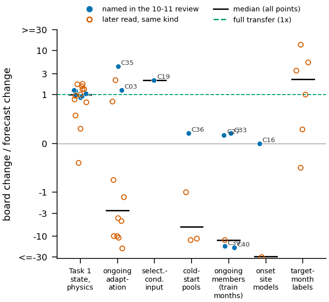

*F4. State pieces read at a median 1.00x their forecast; members trained on train months read at .2x or below zero, and later adaptation reads at a median -4.2x.*

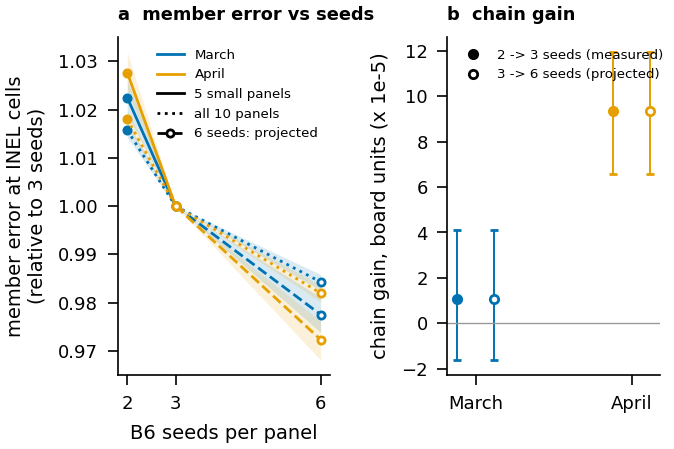

*F12. A third B6 seed is worth +.000093 [+.000066, +.000119] board units in April but +.000011 [-.000016, +.000041] in March; the 6-seed points are projections, not measurements.*

### 6.4 The queue decode bottleneck

Ongoing probabilities are sharp. A median official window has no cell within .034 (March) or .031 (April) of the
decode threshold, while in-model target-month pieces move the cells near it by at most .0036 (DW-ADAPT) and .0013 (TODR).
At its real size the DW move changes one March window and no April window; it has to be scaled 2x (March) or 5x (April)
to change the three windows a board read needs [F13; docs/research/ideas_R4/R4.md 1b]. Scaling such a delta ten times did not help offline: OFF250 lost .0024 IoU [R4.md 1c].
One decoded cell in a 130-cell mask is about .007 IoU, or .00003 S_total [R4.md 1c]. So small ongoing gains are mostly
invisible on the board, and visible ones are mostly window luck. Onset loss is site choice: with the site right the template
IoU is .963, and about half of the misses rank the true site second [R4.md 1e]. The official onset windows sit on days 1 to
6 of the month, so any month-learned onset rule has at most five earlier days to learn from [R4.md 1e].

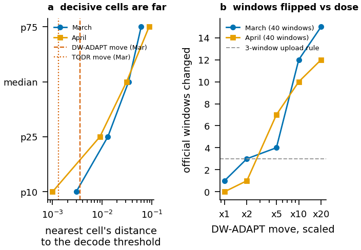

*F13. The median official window has no cell within .034 (March) or .031 (April) of the decode threshold, while target-month pieces move cells near it by at most .0036, so the move must be scaled 2x to 5x to change three windows.*

### 6.5 Label-source dose

F10 plots the gain per label source and dose [F10]. The first official-view step (FV-FT) gave +.00041, a second equal step
+.00002; INEL labels at weight .3 gave +.00025 and at 1.0 +.00002 [T2 rows 28, 30, 31, 34]. At weight .3 the INEL labels were
already 93% fitted in sample [ADVICE_C73 K3]. Each new label source paid once, then the dose curve was flat. Stage learners
fitted on the same labels (S7c) paid again, at a smaller size [T2 row 35]. Held out, INEL-FOLD puts the INEL label class at +.00045 [+.00019, +.00070] (March) and +.00018 [+.00006, +.00032]
(April) board units, and S7c at +.000020 (March) and +.000016 (April) [F10; F11].

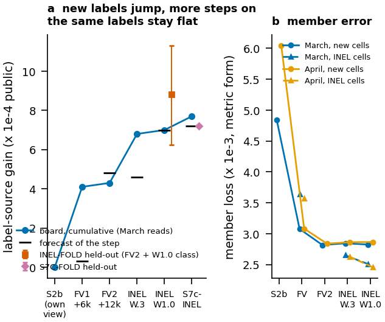

*F10. Each new label source paid once (FV-FT +.00041, INEL +.00025, S7c +.00007) while a second dose of the same labels paid +.00002; held out, the INEL class is above zero in both months.*

## 7. What did not work

The registry holds 267 ideas: 45 ADOPTED, 108 REFUTED, 80 UNDETECTED, 16 BAD-INSTRUMENT, 16 REASONING-ONLY, and 2 that
passed offline but were not shipped [F5; REGISTRY.tsv]. The registry counts sub-pieces and instruments, so its 45 ADOPTED
rows cover the 35 rows of ADOPTED.md. We write "refuted" only when a sound test had enough power; "undetected" means the test could not have seen
the expected effect. T3 lists the most informative refutations with the smallest effect each test could see. The adoption rate is about the same for ideas that learn from the target month (18%) and for those that do not (17%)
[F5]; F5 records breadth, and the evidence for idea 1 is the board record in F3 and F4. *Hypothesis:* after the early
board reads few new train-month ideas were tried, so that group holds mostly early ideas.

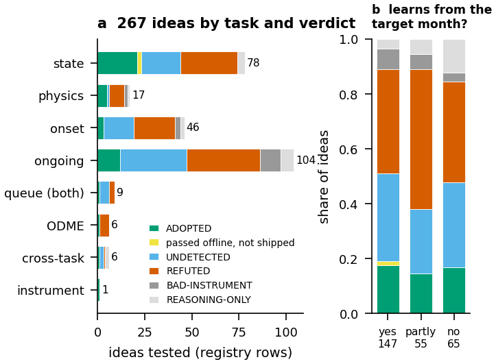

*F5. All 267 registry ideas by task and verdict class; the adoption rate is about the same with (18%) or without (17%) target-month learning.*

**T3. Negative results with test power** [REGISTRY.tsv, columns result and min_effect_test_could_see].

| registry | idea | result | test could see |
|---|---|---|---|
| R098 | ongoing CNN trained and validated on train months, no adaptation | board -.00985 (train folds had it ahead) | .001 |
| R059 | same-month adapted CNN for onset | board -.01097 (pseudo windows .806 vs .761) | .002 |
| R060 | physics or flow-based onset site models | board -.00625; pseudo March +.031 | .002 |
| R191 | schedule-robust onset model (jitter, site dropout) | board -.00699; replay +.043 / +.058 | .002 |
| R157 | KL or entropy-regularised ODME | board -.03024 and -.01279 | .0002 |
| R158 | scale the ODME prior (.85, .93) | board -.01809 and -.00736 (held-out counts favoured it) | .0002 |
| R052 | temporal smoothing of density for physics | board -.00556 | .0002 |
| R025 | train-month free-flow means in the state model | board -.00102 | .0002 |
| R101 | larger ongoing ensemble (K2) | board -.00157 and -.00140; pseudo +.0037 to +.0053 IoU | .0007 |
| R103, R104 | heavier or longer pretrained member | board -.00085 and -.00055 | .0007 |
| R102 | gentler per-date adaptation | split -.0087 / -.0075 IoU; board -.00069 | .0007 |
| R118 | size-aware stacker fitted on pseudo windows | April pseudo +.00242; OFF250 -.0002 to -.0014; board -.00078 | .0007 |
| R212 | distilled ongoing members (TM-R gate passed) | board -.00109 | .0007 |
| R026 | one imputer pooled over train months | own view state -.00226 / -.00155 | .0002 |
| R263 | per-day test-time fine-tune of B6 | member error +7.8% [+5.6%, +10.6%] | member 1% |

T3 is picked for its lessons. The mechanical selection (15 refuted rows with a numeric power, largest efforts first) is
[T3-full](figures/out/T3_negative_results.md); its R015 row (more B6 seeds) is reconciled with F12 in section 6.3.

Three lessons follow from T3. Train-month evidence for queue models misled in sign several times (R098, R101, R103).
Pseudo windows misled corrections fitted on top of the model's output (R118, R191). For ODME the held-out count fit could
not see total mass, and the board rejected what it favoured (R158). Over 2026-10-12 and 10-13, five rounds of fresh-context
helper agents produced no new adopted piece; 4 of 4 open proposals in the first round landed in already tested regions
[docs/report/REPORT_DRAFT.md section 7e]. The generator emulator was killed at its first gate (section 2)
[exp/G_gen/GATE1.md].

## 8. Compliance, leakage audit and limitations

**Online rule (Task 2).** Two read-only audits checked every Task 2 piece. No piece reads a value stamped after T, no April
data reaches a March window, and no Task 1, 3 or 4 output feeds a Task 2 input
[docs/report/TASK2_ONLINE_AUDIT_2026-10-11.md section 1; exp/C_audit748789/AUDIT.md section 1]. Future-poison tests (later
dates and later same-day steps overwritten, adaptation refit, output identical) exist for the CNN members, the cold-date
stage and Q0436 [AUDIT 2026-10-11 section 4]. Open guard gaps are listed in Appendix B.

**Organiser ruling of 2026-10-15 (thread 748789).** The organiser confirmed that everything used for a window, including
model or threshold selection, must be stamped at or before its T, and that April windows may use released March data
[DIGEST]. Every April (private) choice uses only train months and released March data [exp/C_audit748789/AUDIT.md sections
3 and 4].

**Declared April methods.** We declare these uses for April rows:
1. A March board read of a method chose that method for April rows (not for March rows) [DIGEST, ruling 2026-10-15 (a)]:
   ADOPTED 22, 23, 33, and the April parts of 28 to 31, 34 and 35.
2. April gap-stage weights and the gap blend were fitted on April's own released view (Task 1 is offline) [ADOPTED 27;
   DIGEST 2026-10-18].
3. Precedence: in April rows, later queue pieces do not overwrite cells flipped by ADOPTED 22 and 23 [DIGEST 2026-10-17]
4. The April B6 blend weights are the March fit [ADOPTED 16, 24].

**U1, selection-implied inputs (disclosure).** The organiser's ongoing selector keeps a window only if persistence IoU over
the horizon is at most .9, and skips an origin only if its horizon matched persistence. Our ongoing chain uses these facts:
the sccnn flags (window "hard", previous origin type A), the persistence cap at .92 and the type A raise to .8. They are
computed from data at or before T. 43 of 80 official ongoing windows are type A; the selection-conditioned twin (C19) read
+.0045 public and +.0095 private [AUDIT 2026-10-11 U1; ADOPTED 4; P2].

**Leakage checks** [T5]. No IDs, row order, window numbering, mask hashes or generator seeds are features [RULES.md
sections 3 and 5]. Replays with opaque bijective ID changes and row permutations left all ongoing rows and onset choices
unchanged [docs/report/REPRO_README.md, red-team section]. INEL cells are released observations that the metric never scores;
their intersection with scored targets is 0 in both months [T5].

**Pretrained weights and external data.** The final uses one ConvNeXt-Tiny with ImageNet-1k weights
(timm/convnext_tiny.fb_in1k, Apache-2.0), fine-tuned on train only [RULES.md section 3]. Screened and not shipped: other
ImageNet backbones, Big-LaMa, TabPFN v2 ("Built with PriorLabs-TabPFN"), Chronos-Bolt, and a pretraining screen on public
Caltrans PeMS data that failed its first gate [RULES.md section 3; L0790]. No external data is in any final file.

**Limitations.**
- *The S7c forecast miss.* I-S-INEL forecast S7c-INEL at +.00002; the board read +.00007 [T2 row 35]. Our last experiment
  refitted S7c on the INEL-FOLD chain. The refit equals the shipped fit (March fc +.000001), so C80 keeps the shipped trees.
  The honest held-out value of the shipped piece on the shipped chain is +.000020 (March) and +.000016 (April) in board
  units; its in-sample value on its own training cells is +.000069 [R267; exp/L_isinel/LINE.md section 6]. Possible reasons,
  none tested: the variance of one board read is about .00001 [ADVICE_C73 header]; the gain may sit at fronts, which the
  INEL population may weight differently from scored targets; stage-learner effects may be under-read by the instrument. We
  do not claim any of them, and we treat the April value as +.000016, not +.00007.
- *Queue evidence is weak.* 80 windows per split, one window = .00375, and queue forecasts missed by a median .0006 [F3; T4].
  Several adopted queue pieces are within noise of zero.
- *Hidden physics is never measured.* Component levels in T1 are estimates from aggregate reads.
- *Multiple testing.* Ledger rows numbered to 0841 and 90 forecast reads; our own probes were read on 20 UTC days, at most 5 a day (the cap) [LEDGER.md; calib; T4]. We required intervals that
  exclude zero and a board read for adoption, but some small adopted pieces may be noise.
- *April onset.* April pseudo windows were looked at about eight times for onset ideas, so April is not a blind check for
  onset [docs/report/REPORT_DRAFT.md section 7e].

## 9. Reproducibility

**Gate.** The organisers rerun the code; predictions must score within 1% of the selected file's private score
[docs/report/SOURCE_EVALUATION_2026-10-13.md].

**What is proven.** C47 (.89776) was rebuilt from code on CPU only by `TFB_ASM2_CPU_ONLY=1 bash
docs/reference_code/asm2_run_all.sh`. All queue and ODME rows were equal; state rows differed in the last bits only (largest
4.2e-13 km/h and 3.6e-11 vph) [docs/report/REPRO_README.md; exp/C_kbuild/KBUILD.md section 8]. Runtime on a 16-thread laptop
under WSL2: caches 20 min, S08 refit 238 min, onset and ODME 21 min, ongoing 196 min (peak 7.5 GiB), Task 1 chain 38 to 53
min, assembly 8 to 11 min, about 9 h in total [T4; REPRO_README]. Board use and compute: [T4](figures/out/T4_board_reads_compute.md). On 2026-10-21 the solution repository rebuilt C47 again
from its own copy of the code under WSL (`pipeline/10_base_c47.sh --s08-fitted`, 203 min): queue and ODME rows equal, state
rows within 4.19e-13 km/h and 3.64e-11 vph of the submitted file [final_solution/outputs/logs/base_c47.result]. C47 is within .0032 of C80 on the public board [T2], far
inside the gate of about .009.

**C47 to C80.** ADOPTED rows 19 to 35 are not yet in the single build (BUILD = NO). Each was saved at adoption with weights or
fitted files, sha256 receipts and the exact recipe [ADOPTED 19 to 35; .claude/CLAUDE.md]. The solution repository
(`final_solution/`) rebuilds them in adoption order from saved weights, with a parity check per piece:
`pipeline/00_fetch_data.sh`, `01_fetch_weights.sh`, `10_base_c47.sh`, `pipeline/pieces/19_*.sh` to `35_*.sh`, `99_verify.py`
[docs/report/FINAL_PLAN_2026-10-21.md section 3]. Verification run (clean machine): passed on 2026-11-09. Rows 19 to 35 ran in 11.6 h on the laptop from a fresh folder made only from this repository, the release assets and the competition data, with every Python file open audited: nothing outside that folder was read except our two stored files of C79 and C80, read for the final comparison. Every rebuilt member set matched development by sha256, C79 came out byte-equal to the scored submission and C80 to our stored file (VERIFY_PASS). The base C47 was rebuilt separately in WSL (VERIFY_PASS, state rows within 4e-13). Two known exceptions: Q-ACCUM has no weights (per-date online fits in three Kaggle kernels;
stored outputs are sha-checked; leaving it out costs about .00006 public) [ADOPTED 33], and the per-date weights of A1 were
not saved (rerun about .8 GPU h, or stored probabilities with sha) [ADOPTED 23].

**Hardware.** Laptop: 16 CPU threads, 15 GB RAM, RTX 3050 Ti 4 GB. Kaggle: 2x T4 (about 30 GPU h per week). Rented Vast.ai
machines until 2026-10-17 [REVIEW section 7; DIGEST 2026-10-17].

**A simple model.** The B6 imputer alone, per month, is the strongest single state component we found [R007; Appendix A].

---

## Appendix A. Full board history of carried pieces (T2a)

Public S_total, delta vs parent and written forecast [calib; docs/report/REPORT_DRAFT.md section 9; ADOPTED].

| file | change | public | delta | forecast |
|---|---|---|---|---|
| U1 | canonical baseline | .83664 | | |
| U4 | Q03 onset | .84875 | +.01211 | +.0127 |
| Q04 | tree model for ongoing | .85925 | +.01050 | +.0112 |
| F4 | state base | .87732 | +.01807 | +.0076 |
| C03 | adapted CNN for ongoing | .88225 | +.00493 | +.0039 |
| C10 | speed shock, class hedge, flow kriging, projection | .88668 | +.00443 | +.0040 |
| C11 | stage 2 | .88745 | +.00077 | +.0008 |
| C12 | B6 imputer blend | .88793 | +.00048 | +.0004 |
| C13 | polish | .88810 | +.00017 | +.00018 |
| C14 | spatial average and stage 3 | .88940 | +.00130 | +.0015 |
| C15 | S08 input, gap rows and a queue piece (bundle) | .88942 | +.00002 | +.0012 |
| C16 | onset Q0436 | .88942 | 0 | +.00188 |
| C17 | occupancy and joint flow | .88960 | +.00018 | +.00018 |
| C19 | selector-aware ongoing (sccnn on type A) | .89411 | +.00451 | +.0021 |
| C26 | first build output: stage 4, Q0436 | .89440 | +.00029 | +.00030 |
| C28 | pretrained member .2 | .89450 | +.00010 | +.00060 |
| C29 | mix .75 adapted | .89452 | +.00002 | +.00020 |
| C30 | stage 2 size | .89457 | +.00005 | +.00004 |
| C31 | 16 epochs | .89537 | +.00080 | +.00063 |
| C33 | 5 seeds | .89556 | +.00019 | +.00093 |
| C34 | stage 2 rows | .89561 | +.00005 | +.00005 |
| C35 | adaptation recipe | .89631 | +.00070 | +.00016 |
| C36 | cold-start pools | .89667 | +.00036 | +.00169 |
| C43 | S08 refit | .89703 | +.00036 | +.00040 |
| C44 | B6 12k iterations | .89744 | +.00041 | +.00042 |
| C47 | B6 24k, weights refit | .89776 | +.00032 | +.00038 |
| C48 / C50 | gap2 member (C50 = same with saved weights) | .89813 | +.00037 / 0 | +.00024 |
| C54 | knob pair | .89816 | +.00003 | +.00010 |
| C55 | Tiny retrain | .89850 | +.00034 | 0 |
| C57 | A3 | .89907 | +.00057 | -.00005 |
| C59 | A1 | .89956 | +.00049 | +.00023 |
| C64 | B6 S2 | .89964 | +.00008 | +.00006 |
| C65 | gap weights | .89976 | +.00012 | +.00007 |
| C66 | bundle 18 | .89984 | +.00008 | +.00014 |
| C69 | gap members, blend | .89996 | +.00012 | +.00009 |
| C70 | FV-FT March | .90037 | +.00041 | +.00003 |
| C71 | bundle 19 | .90044 | +.00007 | +.00004 |
| C72 | FV2 | .90046 | +.00002 | +.00007 |
| C73 | FV-INEL | .90071 | +.00025 | +.00003 |
| C75 | gap rows over FV | .90073 | +.00002 | +.00002 |
| C76 | Q-ACCUM | .90079 | +.00006 | +.00007 |
| C77 | W1.0 (read on C75 +.00002, stacked; C77 unread) | (.90081 fc) | +.00002 | +.00002 |
| C79 / C80 | S7c-INEL March / + April rows | .90088 | +.00007 | +.00002 |

Forecast = the written forecast level minus the parent's public level, as in F2. Rejected reads are in calib and
summarised in T3. The chain from C03 with the offline evidence of every step is [T2-full](figures/out/T2_ablation.md).

**T1. Component levels** (board-implied estimates from aggregate knockout reads, not measurements; at C72 unless noted)
[docs/research/ideas_R3/R3.md section 1].

| component | weight | level | note |
|---|---|---|---|
| state | .35 | about .947 | +.00036 S_total of state pieces after C72 [T2 rows 31, 32, 34, 35] |
| physics | .15 | about .754 | iid-noise floor about .771 [R5.md 1b] |
| onset | .15 | .8324 | unchanged since |
| ongoing | .15 | .8830 (at C59) | +.00006 S_total after (Q-ACCUM) |
| ODME | .20 | .9933 | |
| host baseline (L0011) | | state .6929, queue .3017, physics .3549, ODME .8359 | total .55343 |

Our own state level at INEL cells of the FV2 chain: .9474 (March), .9483 (April) [R6A.md section 0].

## Appendix B. Compliance checklist (T5) and REFORMS-style items

| check | status | evidence |
|---|---|---|
| Task 2 reads stamped <= T | PASS (audit) | TASK2_ONLINE_AUDIT_2026-10-11 section 1; C_audit748789 section 1 |
| no April data in a March row | PASS by structure (one split per load) | same; mechanical test not yet run (audit gap 6) |
| April selection uses only train months and released March data (ruling 748789) | PASS (audit) | C_audit748789 sections 3 and 4 |
| no IDs, seeds, row order, window numbering as features | PASS | RULES.md sections 3 and 5; red-team replay |
| no day matching across splits | PASS | RULES.md section 3 |
| INEL cells never scored: INEL and target intersection | 0 of 981,093 (March), 0 of 948,791 (April); scored targets 3,451,376 / 3,284,419; recomputed by make_figures.py | artifacts/claude_ref/l_fvinel/inel_count_*.json |
| pretrained weights public, licensed, disclosed | PASS | RULES.md section 3 |
| external data in final | none | RULES.md section 3 |
| future-poison test in the final build | OPEN: ongoing serve steps run without --poison | AUDIT 2026-10-11 gap 1; C_audit748789 section 5 |
| poison covers ramps, window history, every origin | OPEN | AUDIT 2026-10-11 gaps 2, 3 |
| U1 selection-implied inputs | disclosed (section 8) | AUDIT 2026-10-11 U1 |

The generated checklist with the computed INEL and target intersection is [T5](figures/out/T5_compliance.md).

REFORMS-style items: data provenance (section 2); train, validation and test separation by month (section 2); leakage audit
(this table); evaluation units and intervals (section 3); number of board reads and tuning effort (91 reads, 5 per day,
ledger rows to 0841; section 8); negative results with power (section 7); code and weights (section 9).

## Appendix C. Model card (short)

- *Intended use:* the four TrafficFlowBench tasks on the released synthetic data; not tested on real detector data.
- *Training data:* train months for queue members and Q03; the scored month's released cells for state models, B6 members,
  S08, gap rows and stage refits; March data for some April choices (declared, section 8).
- *Evaluation:* public board (March) and our instruments (section 3).
- *Known failure modes:* queue fronts and short excursions in state (section 6.1); site choice in onset (section 6.4);
  long-link density in physics (section 6.2).
- *Pretrained components:* ConvNeXt-Tiny ImageNet-1k (Apache-2.0).

## Appendix D. Disclosures

- U1 selection-implied inputs (section 8).
- Declared April methods 1 to 4 (section 8).
- Public notebooks and forum topics were read for ideas (twelve notebooks, fourteen topics) [L0489]
- Screened, not shipped: TabPFN v2, Big-LaMa, Chronos-Bolt, PeMS pretraining [RULES.md section 3].
- An AI agent system did the engineering (Appendix E).

## Appendix E. The agentic process

**Who did what.** One human set the goal, the budget, the rule interpretations and the final selection. From 2026-09-25 to
10-08 a planner agent (Claude) coordinated four Codex lanes (state, queue, ODME and physics, lead). From 2026-10-08 Claude
Code, Anthropic's coding agent, was the only developer; it ran as a harness that launched helper agents [DIGEST 2026-10-08;
docs/report/REPORT_DRAFT.md section 8a].

**How the harness worked** [LESSONS_AND_CONSTITUTION.md Article 14].
- *State in files.* An idea registry (267 rows, one verdict class each), a ledger (rows to 0841), a register of adopted pieces
  with BUILD status, a calibration table of forecasts and board reads, and a rules digest with every user ruling.
- *Roles.* Ideation agents wrote ideas only, each with different information (13 numbered rounds and six analysis seats R1
  to R6) [docs/research/ideas_L1 to ideas_L13, ideas_R1 to ideas_R6]. A fresh advisor agent ranked the pool against the
  registry and wrote assignments with a predicted result [docs/research/advisor_L1 to advisor_L8; ADVICE_C70, ADVICE_C73,
  ideas_R6/ADVICE_R6]. Worker agents ran one line each in its own folder with a line card (hypothesis, formulation, budget,
  kill and reopen condition) and an attempts table [76 folders exp/L_*]. A read-only critic reviewed between attempts.
- *Protected scorers.* Workers could not edit the instrument that judged them; instruments used date folds and counted reads
  of the confirm month (for example the gap bench, 13 counted April reads) [exp/L_gap/README.md].
- *Guards.* A pre-command hook blocked credential reads and allowed a Kaggle submit only with a manifest line, a written
  forecast and a window-guard PASS [.claude/hooks/probe_guard.py; tools/upload_day.py].
- *Limits.* At most three lines and one critic at a time; a weekly usage cap set by the user.

**What went wrong in the process.** Wrong headroom estimates sent two lanes to ODME for days; the Codex lanes produced 1,093
coordination messages in six days, 61% with no action [docs/report/RETRO_2026-10-06.md section 2]. The supervisor lost one member's
weights with a destroyed machine, and deleted a cache that later work
needed [REVIEW section 5]. Each led to a rule (save weights and a recipe at adoption).

## Appendix F. Figures and tables

Script: final_solution/report/figures/make_figures.py (deterministic; captions in figures/CAPTIONS.md). Made: F1 to F14, T2 to T5 (figures/out/). Not made: the space x time map of F8.

| id | claim (caption) | data |
|---|---|---|
| F1 | pipeline; each stage reads only allowed data (month, stamp) | docs/report/ASSEMBLY.md, FINAL_BUILD_PLAN.md |
| F2 | waterfall U1 to C80, one bar per piece, forecast band | ADOPTED.md, calib |
| F3 | forecast vs board, y = x, by kind: state reads on the line, queue reads scattered | calib |
| F4 | board/forecast ratio by kind of change | REVIEW_2026-10-11 section 2 |
| F5 | registry by component and verdict class | REGISTRY.tsv |
| F6 | space-time maps of cell types and of our error on held-out cells of one March day | INEL-FOLD held-out cells only |
| F7 | FD scatter of our cells over observed, per regime | Task 1 rows, published triangle |
| F8 | lone hidden cells carry 88% of LWR loss; long links hold 70% of physics but 34% of state sensitivity (space x time map not made) | ideas_R5/R5.md; INEL-FOLD proxy |
| F9 | share of improvable state error by fronts, corridor, hour, run length | ideas_R6/R6A.md section 1 |
| F10 | label-source dose curve | ADOPTED 28 to 35; l_inelfold/GATE.json |
| F11 | instrument validation: I-S-INEL forecast vs board; INEL-FOLD bands | l_isinel/GATE.json, l_inelfold/GATE.json |
| F12 | seed step March vs April | l_seed6/SEED6_POWER.json |
| F13 | distance of decisive cells to the decode threshold; windows flipped vs dose | ideas_R4/R4.md 1b, 1c |
| F14 | date-bootstrap distributions of the last six state pieces | I-S-INEL score outputs |
| T1 | component levels | Appendix A |
| T2 | adopted pieces | section 5 |
| T3 | negative results with power | section 7 |
| T4 | compute and runtime | section 9 |
| T5 | compliance checklist | Appendix B |
